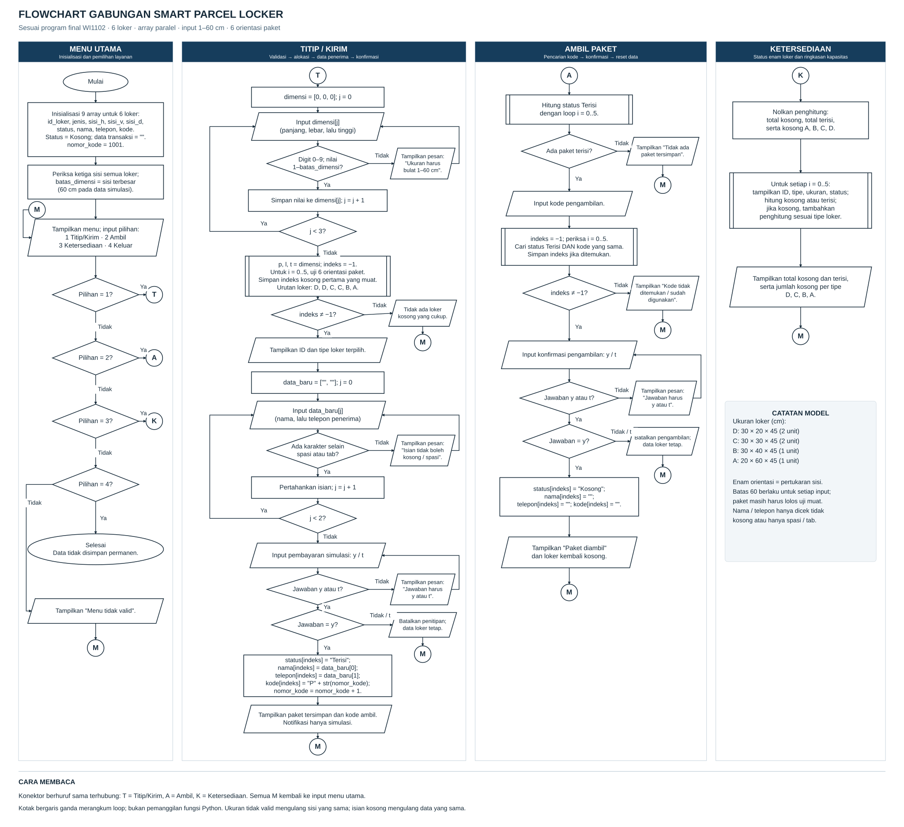

# Smart Parcel Locker

**Projek I · WI1102 Berpikir Komputasional · Kelas 31 · Kelompok 12**  
Semester 1 Tahun Akademik 2026/2027 — Institut Teknologi Bandung

Simulasi loker paket melalui terminal: pengguna dapat menitipkan paket, mengambilnya dengan kode, dan melihat ketersediaan loker. Program memeriksa ukuran serta enam orientasi paket sebelum memilih loker kosong yang sesuai. Data enam loker dikelola dengan **list paralel**, menggunakan sekuens, kondisional, dan perulangan.

PopBox di Apartemen Louvin Jatinangor menjadi konteks pengamatan kelompok. Jumlah dan ukuran loker pada program adalah **parameter simulasi**, bukan hasil pengukuran atau spesifikasi resmi PopBox.

## Dokumen proyek

| Berkas | Isi |
|---|---|
| [Kode Python](WI1102_ProjekI_31_12.py) | Program utama yang dapat langsung dijalankan |
| [Laporan final](documents/WI1102_ProjekI_31_12.pdf) | Deskripsi sistem, berpikir komputasional, algoritma, implementasi, dan pengujian |
| [Laporan Word](documents/WI1102_ProjekI_31_12.docx) · [Sumber LaTeX](documents/Sumber_LaTeX_Berkom.zip) | Berkas laporan yang dapat disunting dan sumber penyusunan PDF |
| [Slide presentasi](documents/Presentasi_Smart_Parcel_Locker.pdf) | Materi presentasi kelompok |
| [Video presentasi](https://drive.google.com/file/d/1F4LFyakFaFF9PxFglL3AjJ7lagQiUMqt/view) | Presentasi dan demo, durasi sekitar 14 menit 30 detik |
| [Flowchart gabungan](docs/Flowchart_Gabungan_Smart_Locker.svg) | Alur menu, penitipan, pengambilan, dan ketersediaan |
| [Penjelasan algoritma](docs/ALGORITMA.md) | Representasi data, validasi, rotasi, dan perubahan status |
| [Rekaman demo terminal](docs/Contoh_Demo.txt) | Contoh masukan dan keluaran dari program final |
| [Ringkasan pengujian](tests/Hasil_Uji_Program.txt) | Daftar 44 skenario dan hasil pemeriksaan alokasi |
| [Data hasil pengujian](tests/code_test_results.json) | Keluaran, keadaan akhir list, dan identitas versi yang diuji |
| [Referensi](docs/REFERENSI.md) | Sumber materi, konteks layanan, dan acuan laporan |

## Menjalankan program

Program utama memerlukan **Python 3**, tanpa paket tambahan. Unduh berkas [WI1102_ProjekI_31_12.py](WI1102_ProjekI_31_12.py), lalu jalankan dari folder tempat berkas disimpan:

```bash
python3 WI1102_ProjekI_31_12.py
```

Pada Windows, perintah yang tersedia dapat berupa:

```powershell
py WI1102_ProjekI_31_12.py
```

Untuk mengunduh seluruh repositori melalui Git:

```bash
git clone https://github.com/athbgs/smart-parcel-locker.git
cd smart-parcel-locker
python3 WI1102_ProjekI_31_12.py
```

Program menampilkan menu berikut:

```text
MENU UTAMA
1. Titip/Kirim paket
2. Ambil paket
3. Ketersediaan loker
4. Keluar
```

| Menu | Perilaku yang sudah diimplementasikan |
|---|---|
| **1 — Titip/Kirim** | Memvalidasi dimensi, memeriksa enam orientasi, memilih loker kosong yang muat, meminta data penerima dan konfirmasi pembayaran simulasi, lalu menerbitkan kode ambil |
| **2 — Ambil** | Mencari kode aktif, meminta konfirmasi, lalu mengosongkan loker serta menghapus data transaksi pada indeks yang sama |
| **3 — Ketersediaan** | Menampilkan ID, tipe, dimensi, status, total kosong/terisi, dan jumlah loker kosong per tipe |
| **4 — Keluar** | Mengakhiri program; data tidak disimpan permanen |

Masukkan dimensi sebagai bilangan bulat **1–60 cm**. Konfirmasi memakai `y` untuk ya dan `t` untuk tidak. Kode pengambilan dicocokkan persis: `P1001` berbeda dari `p1001`.

## Model loker dan pemilihan ukuran

| Tipe | ID | H × V × D (cm) | Jumlah | Volume per loker (cm³) |
|---|---|---:|---:|---:|
| D | L01, L02 | 30 × 20 × 45 | 2 | 27.000 |
| C | L03, L04 | 30 × 30 × 45 | 2 | 40.500 |
| B | L05 | 30 × 40 × 45 | 1 | 54.000 |
| A | L06 | 20 × 60 × 45 | 1 | 54.000 |

H, V, dan D menyatakan sisi horizontal, vertikal, dan kedalaman loker. Satu loker menampung satu paket. Program menelusuri urutan **D, D, C, C, B, A** dan mempertahankan loker kosong pertama yang muat. Urutan volume tidak menurun; jika B dan A sama-sama tersedia serta muat, B dipilih dahulu.

Kecocokan ditentukan oleh **ketiga sisi**, bukan volume saja. Paket `60 × 45 × 20 cm`, misalnya, muat di A setelah diorientasikan menjadi `20 × 60 × 45 cm`. Sebaliknya, `60 × 60 × 60 cm` memenuhi rentang input tetapi tetap tidak muat di loker mana pun.

Batas input 60 cm diperoleh dari sisi terpanjang seluruh inventori. Batas yang sama berlaku pada panjang, lebar, dan tinggi agar paket tetap dapat diperiksa setelah diputar. Nilai `61` atau `9999` ditolak dan diminta ulang pada dimensi yang sama.

## Data dan materi kuliah

Satu indeks selalu merujuk pada satu loker. Contohnya, `id_loker[0]`, `status[0]`, `nama[0]`, dan `kode[0]` semuanya milik L01.

| Kelompok list | Peran |
|---|---|
| `id_loker`, `jenis` | Identitas dan tipe loker |
| `sisi_h`, `sisi_v`, `sisi_d` | Dimensi ruang untuk pemeriksaan kecocokan |
| `status` | Keadaan `Kosong` atau `Terisi` |
| `nama`, `telepon`, `kode` | Data penerima dan kode transaksi aktif |

Kesembilan list tersebut mempunyai enam elemen. List bantu `dimensi`, `label_dimensi`, `label_data`, dan `data_baru` digunakan untuk masukan saat ini. Implementasi tidak menggunakan fungsi buatan sendiri, kelas, database, atau library tambahan.

| Materi | Penerapan | Lokasi dalam kode |
|---|---|---|
| Sekuens | Meminta data, mengonfirmasi, memperbarui transaksi, lalu menampilkan hasil | [Baris 106–130](WI1102_ProjekI_31_12.py#L106-L130) |
| Kondisional | Memeriksa ukuran, status kosong, dan kecocokan kode | [Baris 89–98](WI1102_ProjekI_31_12.py#L89-L98), [143–146](WI1102_ProjekI_31_12.py#L143-L146) |
| Perulangan | Mengulang menu dan input; menelusuri semua loker | [Baris 49–81](WI1102_ProjekI_31_12.py#L49-L81), [88–98](WI1102_ProjekI_31_12.py#L88-L98) |
| Array | Menyimpan list paralel dan mengubah elemen pada indeks transaksi | [Baris 17–27](WI1102_ProjekI_31_12.py#L17-L27), [123–126](WI1102_ProjekI_31_12.py#L123-L126), [155–158](WI1102_ProjekI_31_12.py#L155-L158) |

Dalam rancangan berpikir komputasional, **dekomposisi** membagi proses menjadi titip, ambil, ketersediaan, dan kendali menu. **Abstraksi** mempertahankan ukuran, status, dan kode yang diperlukan untuk keputusan. **Pengenalan pola** terlihat pada pencarian berurutan, validasi sebelum perubahan data, serta siklus `Kosong → Terisi → Kosong`.

## Diagram alur

[Buka flowchart gabungan ukuran penuh](docs/Flowchart_Gabungan_Smart_Locker.svg). Konektor `M` mengembalikan proses ke menu; `T`, `A`, dan `K` menghubungkan cabang titip, ambil, dan ketersediaan.

<details>
<summary>Tampilkan flowchart</summary>



</details>

Penjelasan langkah dan perubahan data tersedia di [ALGORITMA.md](docs/ALGORITMA.md). Laporan memuat diagram per bagian agar tetap mudah dibaca pada halaman cetak.

## Contoh penggunaan

Berikut rangkaian dari [rekaman terminal final](docs/Contoh_Demo.txt), dengan data penerima contoh:

| Langkah | Masukan utama | Hasil |
|---|---|---|
| 1 | Titip `60 × 45 × 20`, konfirmasi `y` | L06 tipe A terisi, kode `P1001` |
| 2 | Titip `30 × 20 × 45`, konfirmasi `y` | L01 tipe D terisi, kode `P1002` |
| 3 | Coba kode yang salah | Ditolak; transaksi yang tersimpan tetap utuh |
| 4 | Ambil `P1001`, konfirmasi `y` | L06 kembali kosong; data penerima dan kode L06 dihapus |
| 5 | Coba kembali `P1001` | Ditolak karena kode sudah digunakan |
| 6 | Lihat ketersediaan | L01 terisi, lima loker lainnya kosong |

Rekaman terminal ini terpisah dari [video presentasi kelompok](https://drive.google.com/file/d/1F4LFyakFaFF9PxFglL3AjJ7lagQiUMqt/view).

## Pengujian

Hasil pengujian final **19 Oktober 2026**:

| Pemeriksaan | Cakupan | Hasil |
|---|---|---|
| Skenario perilaku program | 24 skenario alur + 12 orientasi A/B + 8 regresi batas input | **44/44 lulus** |
| Blok pemilihan loker | 4.096 kombinasi dimensi × 64 pola keterisian | **262.144 pemeriksaan, 0 ketidaksesuaian** |
| Sintaks program utama | Pemeriksaan konstruksi dan pemanggilan dasar yang digunakan | **Lulus pemeriksaan alat uji** |

Skenario perilaku memeriksa keluaran **dan keadaan akhir list**, termasuk pembatalan transaksi, loker penuh, kode salah/bekas, penggunaan kembali loker, dan pengulangan input yang tidak valid. Pada setiap skenario, loker kosong harus mempunyai data transaksi kosong dan semua kode aktif harus unik.

Sebanyak 262.144 pemeriksaan tambahan dijalankan pada **blok alokasi secara terpisah**, bukan 262.144 transaksi lengkap atau seluruh kemungkinan ukuran. Nilai per sisi yang diperiksa adalah `1, 19, 20, 21, 29, 30, 31, 39, 40, 41, 44, 45, 46, 59, 60, 61`. Nilai 61 merupakan kasus negatif untuk pemeriksaan blok; input terminal tetap menolaknya.

Revisi batas dimensi memakai TDD: alat uji lebih dahulu menghasilkan **34/44 lulus dan 10 gagal** pada kode lama, kemudian **44/44 lulus** setelah perbaikan. Delapan skenario baru menambah cakupan regresi; ekspektasi beberapa tes lama juga disesuaikan sebelum tahap RED.

Untuk menjalankan alat uji opsional, gunakan Python 3.9 atau lebih baru dengan data zona waktu `Asia/Jakarta` tersedia:

```bash
python3 tests/test_smart_locker.py
```

Perintah tersebut menulis ulang `tests/Hasil_Uji_Program.txt` dan `tests/code_test_results.json`. Alat uji menggunakan pustaka standar dan teknik yang lebih lanjut; berkas ini terpisah dari program utama yang mengikuti materi dasar WI1102.

Identitas sumber pada hasil uji final:

```text
WI1102_ProjekI_31_12.py
SHA-256: bc986a4a9cf8564d3b2ed7a305c99e4854f5eb2dd9b54e5a72a665ccf521cb21
```

## Batas simulasi

- Paket dianggap balok kaku. Rotasi terbatas pada enam pertukaran arah sisi; kemiringan diagonal, toleransi kemasan, dan celah pintu diabaikan.
- Enam loker dan ukurannya merupakan asumsi simulasi. Tidak ada antrean ketika seluruh loker yang sesuai sudah terisi.
- Nama dan telepon hanya diperiksa agar tidak kosong atau seluruhnya spasi/tab. Format serta kepemilikan nomor belum diverifikasi.
- Kode `P1001` dan seterusnya unik selama satu sesi, berurutan, dan bukan mekanisme autentikasi untuk sistem operasional.
- Data dan penghitung kode direset saat program dimulai ulang. Tidak ada penyimpanan permanen atau riwayat transaksi.
- Pembayaran dan notifikasi hanya disimulasikan lewat terminal. Program tidak terhubung ke uang, WhatsApp, sensor, atau pintu fisik.

Penyimpanan permanen, autentikasi, dan integrasi perangkat belum diimplementasikan. Hasil uji berlaku pada logika simulasi ini; pengujian tidak menilai keamanan atau keandalan layanan PopBox.

## Anggota dan pembagian tugas

| Nama | NIM | Tanggung jawab |
|---|---|---|
| Athaillah Bagas Rachmansyah | 16726244 | Deskripsi sistem, dekomposisi, kebutuhan dan alur kerja; koordinasi serta penyuntingan laporan |
| Syifa Alika Ramadhani | 16726298 | Perancangan flowchart, urutan proses dan percabangan; kesesuaian dengan rancangan program |
| Qurratuaini Qalbi Mirxela | 16726326 | Pembuatan dan penyuntingan flowchart, pemeriksaan simbol serta logika, penyesuaian terhadap implementasi |
| Ahmad Naufal Hafidzhi | 16726446 | Pengembangan program, proses utama, pengolahan data, dan pengujian fungsi |
| Hatta Adnan Wildan | 16726306 | Pengembangan serta penyuntingan kode, input/output, validasi, dan debugging |

Asistensi dilaksanakan pada **17 Oktober 2026** bersama **Fawwazi Arhaqi**. Masukan tentang penerapan materi kuliah, terutama array, ditindaklanjuti dengan penggunaan list paralel sebagai data bersama seluruh proses.

## Struktur repositori

```text
smart-parcel-locker/
├── WI1102_ProjekI_31_12.py
├── README.md
├── documents/
│   ├── WI1102_ProjekI_31_12.pdf
│   ├── WI1102_ProjekI_31_12.docx
│   ├── Sumber_LaTeX_Berkom.zip
│   └── Presentasi_Smart_Parcel_Locker.pdf
├── docs/
│   ├── ALGORITMA.md
│   ├── REFERENSI.md
│   ├── Flowchart_Gabungan_Smart_Locker.svg
│   └── Contoh_Demo.txt
└── tests/
    ├── test_smart_locker.py
    ├── Hasil_Uji_Program.txt
    └── code_test_results.json
```

Sumber dan cara penggunaannya dijelaskan di [Referensi](docs/REFERENSI.md). Laporan terdahulu digunakan sebagai acuan penyajian; implementasi dan hasil pengujian dalam repositori ini berasal dari model Smart Parcel Locker.

Seperti dicatat dalam laporan, bantuan AI digunakan dalam revisi program, pengujian otomatis, penyusunan ilustrasi, dan penulisan. Setiap anggota tetap perlu memahami rancangan dan hasil yang dipresentasikan.
